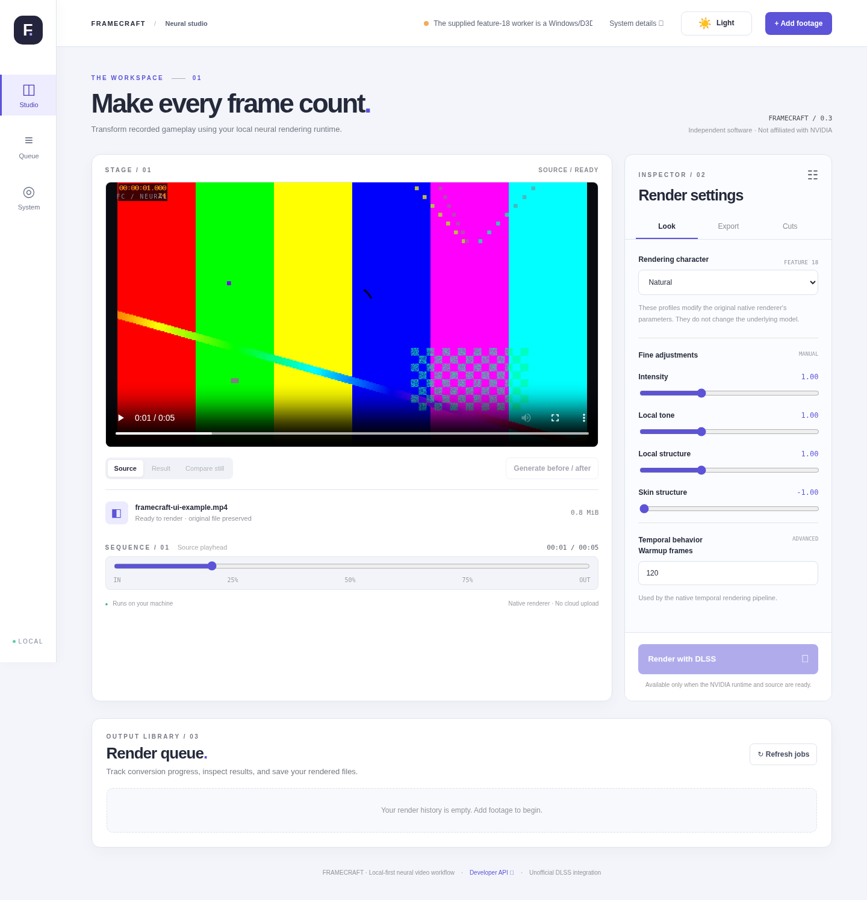

# Framecraft

Framecraft is a local video editor and FastAPI web UI for the user-supplied native
DLSS neural rendering **feature-18** worker used by
[DLSS5-Video-Converter](https://github.com/perseval-BLR/DLSS5-Video-Converter).
Upload recorded footage, choose a rendering character, keep selected cuts, and
export a verified video with its original audio and a JSON evidence report.

This is an independent, experimental integration, not an NVIDIA product. It does
not include the proprietary worker, neural model, drivers, or FFmpeg. Profile
names describe this application's parameter presets; actual visual results depend
on the supplied native runtime and the footage.

## Requirements

| Component | Requirement |
| --- | --- |
| Python | 3.12–3.14; 3.12 or 3.13 is a practical starting point |
| Package manager | [uv](https://docs.astral.sh/uv/getting-started/installation/) |
| Video rendering | Windows 10/11, compatible GeForce RTX hardware, working NVIDIA drivers, and the matching native worker/model |
| GPU compatibility | RTX 30/40/50 names pass the application's filter; actual feature-18 compatibility still requires a real render |
| Media tools | FFmpeg and ffprobe, downloaded separately; NVENC support for the fixed export recipes and `libx264` for browser samples |
| Input | SDR video: MP4, MKV, WEBM, MOV, AVI, or M4V |

The UI, API, and development tests run on Linux or CPU-only machines. **Native
DLSS rendering does not:** the supplied worker uses Windows/D3D12. H100/H200 are
not supported by default, and CUDA capability alone does not establish NGX/D3D12
compatibility. HDR input is rejected. Processing keeps the source dimensions;
this integration does not upscale video or generate interpolated frames.

## Download and place the external files

Download the native runtime ZIP from
[the runtime release](https://github.com/fazli-m9929/framecraft/releases/tag/dependencies-v1)
under **Assets**. Extract it into the Framecraft folder so `runtime/` and
`preview/` sit beside `pyproject.toml`. Keep the supplied worker and model together.
The automatic **Source code** downloads are not the runtime ZIP.

**FFmpeg and ffprobe are not included in the runtime download.** Download a
Windows build from [ffmpeg.org/download.html](https://ffmpeg.org/download.html)
containing both `ffmpeg.exe` and `ffprobe.exe`. Place them under
`bin/ffmpeg/bin/`, add their directory to `PATH`, or configure the paths in `.env`
as shown below. `uv sync` installs Python dependencies, not these external tools.

Expected folder layout when using bundled FFmpeg:

```text
framecraft/
├── pyproject.toml
├── uv.lock
├── src/
├── web/
├── runtime/
│   ├── nvngx.dll              # required native video worker executable
│   └── nvngx_dlssnr.dll       # required matching neural model
├── bin/
│   └── ffmpeg/
│       └── bin/
│           ├── ffmpeg.exe
│           └── ffprobe.exe
├── preview/                   # optional, only for still-image comparisons
│   ├── dlssnr-image.exe
│   └── caller/
│       └── nvngx.dll          # separate image caller, not the video worker
└── data/                      # created/populated by the application
```

The main `runtime/nvngx.dll` is an executable worker invoked with `--video`, despite
its extension. **Do not substitute an ordinary NVIDIA driver DLL.** Verify the
source and integrity of these external binaries before running them. The optional
preview executable and its caller come from the compatible upstream preview
package. When needed, the app copies the model from `runtime/` into `preview/`.
Video rendering does not require the optional image-preview files.

Instead of bundling FFmpeg under `bin/`, you can install `ffmpeg` and `ffprobe` on
`PATH` or set explicit paths in `.env`:

```dotenv
NVS_FFMPEG=C:/Tools/ffmpeg/bin/ffmpeg.exe
NVS_FFPROBE=C:/Tools/ffmpeg/bin/ffprobe.exe
```

Lookup order is an explicit override, the bundled `bin/ffmpeg/bin/` directory,
then `PATH`. Run diagnostics below to check which executables were selected.
Linux development can use system FFmpeg/ffprobe, but that does not enable native
DLSS rendering.

## Install and run with uv

In PowerShell, from the directory where you want the checkout:

```powershell
git clone https://github.com/fazli-m9929/framecraft.git
cd framecraft
uv sync --frozen
uv run nvs doctor
uv run nvs serve
```

`uv sync --frozen` installs the locked application dependencies into `.venv`.
There is no Node/frontend build. Download and place the external files before
expecting a render to work. Configuration is optional: if you need overrides,
copy `.env.example` to `.env` manually and edit it without overwriting an existing
configuration.

Open **http://127.0.0.1:7860** in your browser. Interactive API documentation is at
**http://127.0.0.1:7860/docs**. Stop the server with **Ctrl+C**.

`uv run nvs doctor` reports `gpus`, `missing`, `ffmpeg`, `ffprobe`,
`render_available`, `preview_available`, and `reason`. A true render flag means
basic prerequisites passed; it is not proof that inference succeeds.

To select another local port:

```powershell
uv run nvs serve --host 127.0.0.1 --port 7861
```

The application has no authentication. Keep the default loopback binding. Anyone
who can reach the server can upload files and submit native jobs; do not expose
it directly to the public internet.

## UI example: render a short gameplay clip

<!-- Replace docs/images/editor-example.png with your own screenshot; keep this filename. -->


Editor example with sample footage; the image is not a before/after render comparison.

Start with a 5–10 second SDR recording on your compatible Windows RTX machine.

1. Click **+ Add footage** or drop the video into the Stage. Play the source to
   check that you selected the intended file.
2. In **Look**, select **Natural** for a moderate starting point. Selecting a
   character resets the four sliders to that character's defaults. Leave
   **Warmup frames** at **120** for the first test.
3. In **Export**, choose **H.264 - Compatible (CQ20)** for broad player support.
   Choose **Source** for output frame rate so this test keeps the original rate.
4. In **Cuts**, enter `0-5` to retain the first five seconds, or leave the field
   empty to process the whole video.
5. Click **Render with DLSS** and watch **Render queue** for progress. Failed jobs
   show an error; only completed and verified jobs expose downloadable results.
6. On the completed job, click **▶ Watch 12s sample**. For this short example the
   sample contains the available output, up to 12 seconds. It is an H.264/AAC
   viewing copy of the actual processed result, not a second DLSS render.
7. Use **Try full playback** to open the original export in the browser, or
   **↓ Download full video** to view it in an external player. Open **JSON report**
   to inspect frame counts, native result codes, selected settings, and binary hashes.

If the optional image worker is installed, **Generate before / after** compares a
single frame at the source player's current timestamp. It uses a separate static
image path with narrower control ranges, so it may differ from the temporal
video render. Use the completed video to judge motion and temporal artifacts.

For a longer recording, this Cuts example keeps the first 547 seconds and then
resumes at 945 seconds through the end:

```text
0-547
945-end
```

Times are in seconds, decimals are allowed, starts are inclusive, and ends are
exclusive. Intervals must be chronological and nonoverlapping; an `end` interval
must be last. The same intervals trim source audio, and motion history resets at
cuts. Selected footage is decoded once to count frames and again for rendering.

## Rendering characters: Faithful, Natural, Cinematic, Extreme

These presets change native parameters, not the underlying model. Their intended
character is a tuning guide; compare short renders on your own footage before
choosing settings for a full recording.

| Rendering character | Intended starting point | Intensity | Local tone | Local structure | Skin structure |
| --- | --- | ---: | ---: | ---: | ---: |
| Faithful | A restrained treatment when retaining the source look matters most | 0.70 | 0.75 | 0.75 | -1.00 |
| Natural | Moderate processing; a useful first comparison against the source | 1.00 | 1.00 | 1.00 | -1.00 |
| Strong / Cinematic | A stronger, more stylized treatment; the initial UI default | 1.65 | 1.40 | 1.50 | 1.00 |
| Extreme / Overdrive | An aggressive experiment for comparing the model's response | 2.50 | 2.00 | 2.00 | 1.50 |

Faithful and Natural differ in the native profile/style identifiers as well as
slider strengths. Lowering Cinematic's sliders therefore does not necessarily
reproduce Faithful. For reference, the exact hidden native defaults are:

| Character | profile | preset | style | auto_mask | ui_correction |
| --- | ---: | ---: | ---: | ---: | ---: |
| Faithful | 0 | 0 | 0 | 0 | 0 |
| Natural | 1 | 0 | 1 | 0 | 0 |
| Strong / Cinematic | 2 | 2 | 2 | 1 | 0 |
| Extreme / Overdrive | 2 | 2 | 2 | 1 | 0 |

These are upstream worker identifiers/flags, not separate exposed controls. Their
internal algorithms are not defined by this Python wrapper. Do not confuse the
native `preset` identifier with FFmpeg's P6/P7 encoding preset.

### Look controls

| Setting | Range/default | What to expect when tuning |
| --- | --- | --- |
| Intensity | 0–3; profile-dependent | Overall native strength input. Try lower values for subtler treatment and higher values for a stronger effect; zero is not guaranteed to bypass inference. |
| Local tone | 0–3; profile-dependent | Native local-tone input, intended to influence local tonal/contrast treatment. Compare shadows and highlights as you adjust it. It is not a documented exposure or gamma control. |
| Local structure | 0–3; profile-dependent | Native local-detail/structure input. Compare textures and edges; stronger settings may exaggerate detail or artifacts depending on the model. |
| Skin structure | -1–3; profile-dependent | Native skin-detail input. `-1` is passed through as the upstream sentinel used by Faithful/Natural; its exact internal behavior is runtime-defined. Positive values request explicit skin-structure tuning. |
| Warmup frames | 0–1000; default 120 | Count passed in the worker startup header for temporal initialization. It does not select output FPS or add a UI trim. Exact warmup handling and cost are runtime-dependent; keep the default initially. |

The video wrapper forwards the slider values without simulating their effects.
The separate image preview clamps intensity/tone/structure to 0–2 and skin to
-1–2. To compare settings, render the same short cut with one change at a time;
inspect faces, fine textures, scene transitions, ghosting, and flicker in motion.
Higher numbers are not automatically better quality.

## Export settings

Export controls affect compression, file compatibility, and timing after native
processing. They do not change the DLSS model or restore detail it did not emit.

| Export recipe | Encoder and format | Intended tradeoff |
| --- | --- | --- |
| HEVC Main10 - Maximum quality (CQ18) | `hevc_nvenc`, P7, Main10, `p010le` | Lower CQ target, generally larger files and less compression |
| HEVC Main10 - Balanced (CQ20) | `hevc_nvenc`, P7, Main10, `p010le` | Default balance of quality and size |
| HEVC Main10 - Smaller files (CQ24) | `hevc_nvenc`, P7, Main10, `p010le` | Higher compression, generally smaller files |
| H.264 - Compatible (CQ20) | `h264_nvenc`, P6, `yuv420p` | Broad player compatibility |
| AV1 - Efficient (CQ20) | `av1_nvenc`, P6, `yuv420p` | Efficient compression; requires compatible AV1 hardware and players |
| Custom | Choose codec, container, and quality | Manual encoding choices |

All five fixed recipes use MP4, VBR constant-quality encoding, faststart, and
AAC 384 kbps / 48 kHz when source audio exists. They require the named NVENC
encoder; a listed encoder does not guarantee the GPU can execute it. CQ values
are quality targets, not fixed bitrates or directly comparable across codecs.
P7/P6 are encoding effort presets, not DLSS strength controls.

**Main10 is still lossy and the native frames are RGBA8.** Packing them into a
10-bit file does not recover missing 10-bit precision or make the source HDR.
Video is encoded once, then copied into the final container during audio muxing.

| Other setting | Behavior |
| --- | --- |
| Output frame rate: Source | Keep source timing rather than requesting 60 FPS conversion. |
| Output frame rate: 60 | FFmpeg duplicates/drops frames to make 60 FPS; DLSS does not interpolate new motion frames. The UI initially selects 60; the API default is Source. |
| Custom codec | H.264, HEVC, or AV1. The implementation selects an available NVENC encoder first, with CPU encoder selection for H.264/HEVC when NVENC is not listed. It does not retry a failed NVENC hardware job on CPU. CPU encoding does not enable CPU DLSS inference. |
| Custom container | MP4 or MKV. Fixed recipes require MP4. Browser playback depends on both codec and container. |
| Custom quality: High / Balanced / Small | CQ or CRF 17 / 20 / 24 respectively; lower targets generally retain more detail at larger sizes. |
| Custom quality: Lossless | Requests lossless video encoding for H.264/HEVC. It does not undo native changes or guarantee lossless audio; AV1 lossless is rejected. |
| Cuts | Process only the retained source intervals; blank means the full recording. |

Legacy job recipe names `Standard` and `HEVC 10-bit / NVENC P7 CQ20` still load as
Custom and the balanced HEVC recipe respectively.

## Configuration and saved files

All `.env` entries are optional. Paths are relative to the repository root unless
absolute. Existing environment variables take precedence over `.env` values.

| Variable | Default | Purpose |
| --- | --- | --- |
| `NVS_HOST` | `127.0.0.1` | Local server bind address |
| `NVS_PORT` | `7860` | Server TCP port |
| `NVS_RUNTIME_DIR` | `runtime` | Video worker and model directory |
| `NVS_PREVIEW_DIR` | `preview` | Optional image worker directory |
| `NVS_DATA_DIR` | `data` | Uploads, job records, outputs, and temporary files |
| `NVS_FFMPEG` / `NVS_FFPROBE` | Automatic lookup | Explicit paths to the media executables |
| `NVS_MAX_UPLOAD_GB` | `20` | Maximum size of one upload, in GiB |
| `NVS_ALLOW_UNVERIFIED_GPU` | `false` | Bypass GPU-name filtering on Windows only; does not establish compatibility |

Uploads remain in `data/uploads/`, job status in `data/jobs/`, verified videos and
reports in `data/outputs/`, and viewing samples in `data/samples/`. Temporary work
uses `data/scratch/`. Jobs run one at a time; interrupted jobs are marked failed
after a server restart. There is no automatic upload/output retention cleanup.
Allow space for source copies, intermediates, outputs, and samples. Preserve
`.env`, `runtime/`, `preview/`, manually installed tools, and `data/` when updating.

## Troubleshooting

- **Render unavailable:** run `uv run nvs doctor`; inspect `missing`, `gpus`, and
  `reason`. Check Windows, drivers, matching runtime files, and tool paths.
- **FFmpeg/ffprobe missing:** check the directory layout or configure both absolute
  executable paths. Inspect `ffmpeg -encoders` in the selected build for the needed
  encoder. Browser samples require `libx264`.
- **Encoder listed but render fails:** encoder listing checks build support, not
  actual GPU execution. Read the surfaced FFmpeg error for driver/hardware issues.
- **Still preview unavailable:** add the optional image executable and its separate
  caller, or skip preview and judge a short completed video.
- **HEVC/Main10 or MKV won't play in the browser:** use the 12-second sample or
  download the full file for an external player. Samples do not alter full output.
- **Unexpected appearance:** compare Faithful and Natural on the same short SDR
  clip, then adjust one control at a time. Motion vectors are estimated with
  OpenCV DIS, not supplied by a game engine; artifacts remain possible.
- **A/V sync concerns:** check a real exported sample in motion. Metadata/frame
  checks are useful evidence, not proof of frame-perfect sync for every VFR source.

## Development

```powershell
uv sync --frozen --extra dev
uv run pytest -q
uv run ruff check src tests
```

The existing tests exercise API behavior, clip selection, motion guides, export
arguments, browser samples, and the binary packet protocol. The fake-worker test
checks interoperability only, not neural inference. Full native end-to-end
validation still requires your Windows RTX machine and trusted runtime binaries.

Python functions use input/output annotations and Google-style docstrings with a
one-line summary, `Args` when applicable, and `Returns`. Class docstrings describe
constructor fields or the class responsibility. The frontend is plain HTML/CSS/JS
under `web/`; the Python application is under `src/nvs/`.

See [CHANGELOG.md](CHANGELOG.md) for release history and [LICENSE](LICENSE) for the
application license. External FFmpeg builds, model files, and native workers have
their own licensing and provenance requirements.
